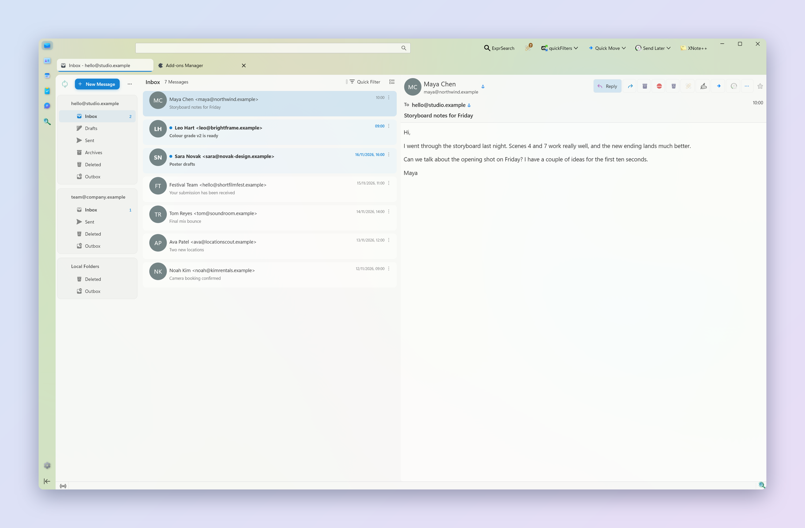
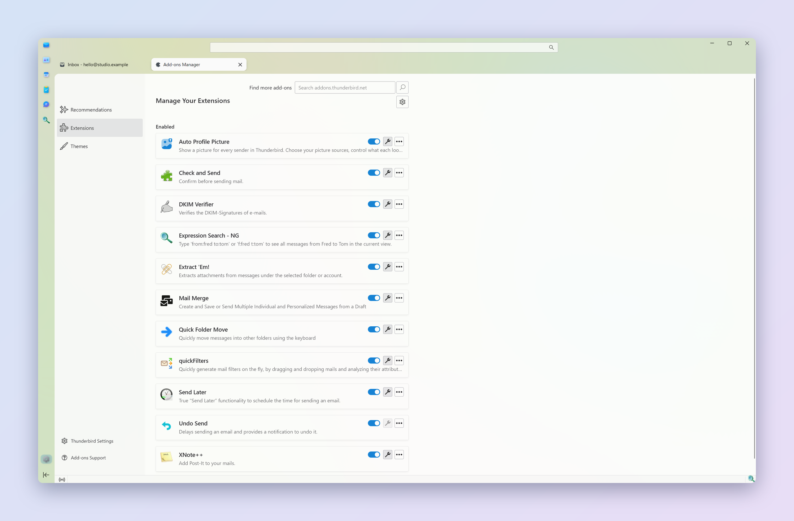
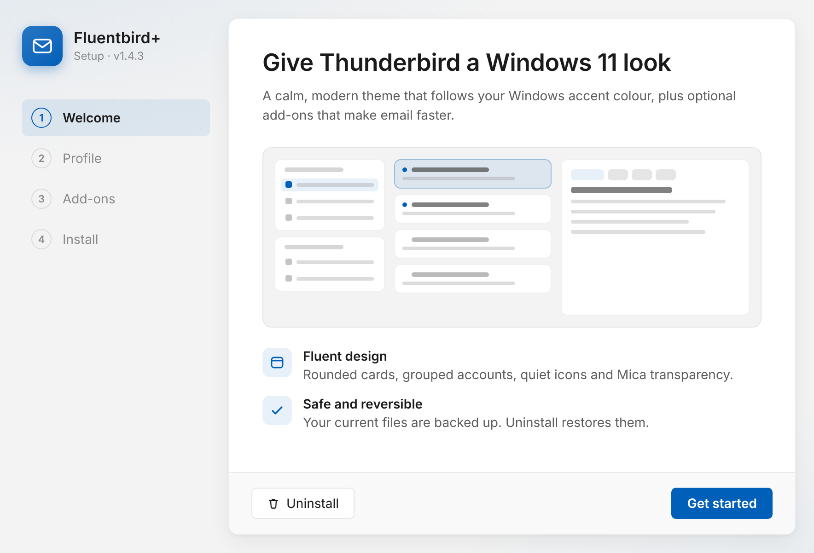
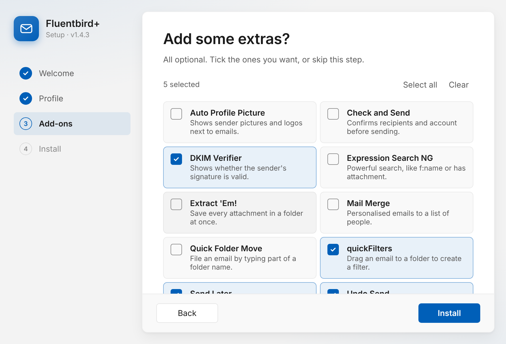
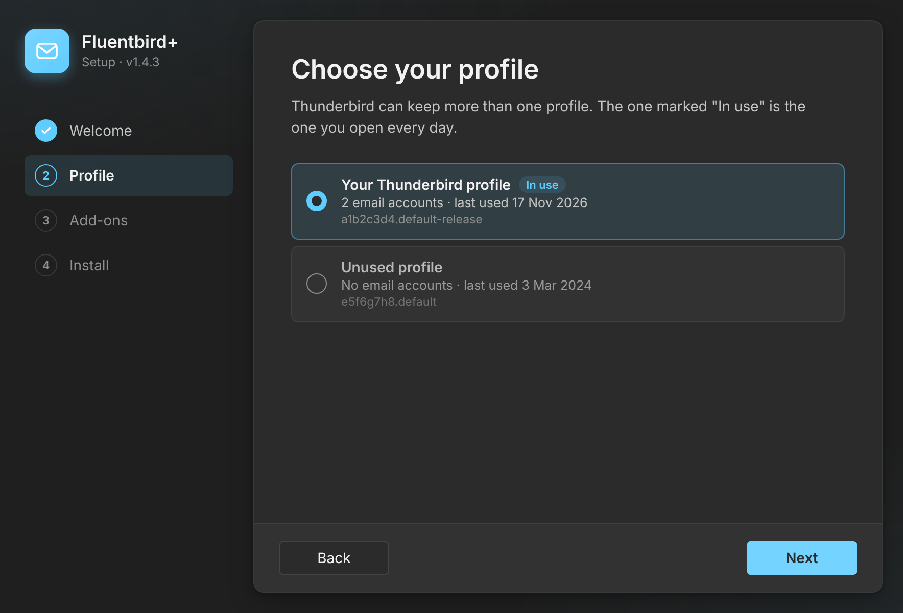
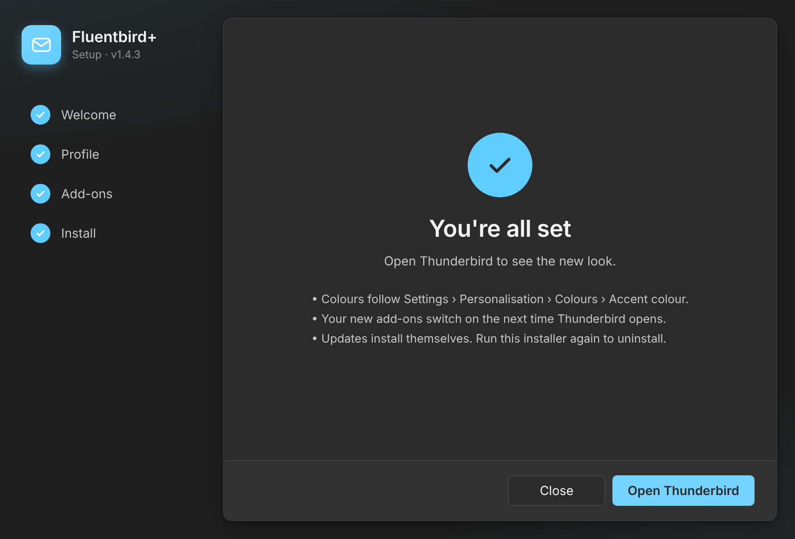

<div dir="rtl">

<p align="center"></p>

<h1 align="center">Fluentbird+</h1>
<p align="center">ظاهر ویندوز ۱۱ برای Thunderbird، همراه با افزونه‌های کاربردی، با یک نصب.</p>
<p align="center"><a href="README.md">English</a> · <b>فارسی</b></p>

<p align="center"></p>

> **ساخته‌شده بر پایه‌ی [Fluentbird](https://github.com/Deathbyteacup/fluentbird) اثر Danny King.**
> Fluentbird به Thunderbird ظاهر Fluent Design و شفافیت Mica ویندوز ۱۱ را می‌دهد. طراحی اصلی کار Danny است.
> اگر از آن خوشتان آمد، به [Fluentbird](https://github.com/Deathbyteacup/fluentbird) ستاره بدهید.

## Fluentbird و Fluentbird+

| | Fluentbird | آنچه Fluentbird+ اضافه می‌کند |
|---|---|---|
| طراحی | Fluent Design، شفافیت Mica، آیکون‌های Fluent، کارت‌های گرد | رنگ‌گرفتن از Accent ویندوز، گروه‌بندی حساب‌ها، آیکون‌های آرام پوشه‌ها، نقطه‌ی نخوانده، هدر یک‌ردیفه‌ی ایمیل |
| نصب | کپی دستی فایل‌ها و تغییر تنظیمات | یک نصب‌کننده، با حذف کامل و تمیز |
| افزونه‌ها | | ۱۱ افزونه‌ی اختیاری، با یک تیک در نصب‌کننده |
| به‌روزرسانی | | به‌روزرسانی خودکار، در صورت تمایل |

Fluentbird+ فایل‌های Fluentbird را بدون تغییر نگه می‌دارد. تغییرات خودش را در فایل جداگانه‌ی
[`custom.css`](custom.css) می‌گذارد، همان فایلی که Fluentbird برای تنظیمات شخصی در نظر گرفته است.
توضیحات اصلی Fluentbird در [docs/FLUENTBIRD.md](docs/FLUENTBIRD.md) نگه داشته شده است.


## چه چیزهایی می‌گیرید

- **طراحی Fluent**: کارت‌های گرد، هر حساب در گروه خودش، آیکون‌های آرام و شفافیت Mica.
- **هماهنگ با رنگ Accent ویندوز**: رنگ را در تنظیمات ویندوز عوض کنید، Thunderbird هم عوض می‌شود.
- **ایمیل‌های نخوانده‌ی واضح**: یک نقطه‌ی رنگی کوچک و نام فرستنده‌ی پررنگ.
- **هدر مرتب ایمیل**: یک ردیف دکمه که جابه‌جا نمی‌شود.
- **روشن و تیره**: از تم ویندوز پیروی می‌کند.
- **افزونه‌های اختیاری**: هرکدام را بخواهید تیک بزنید، بقیه‌ی کار با نصب‌کننده است.

| افزونه | کاربرد |
|---|---|
| Auto Profile Picture | عکس و لوگوی فرستنده کنار ایمیل‌ها |
| Check and Send | تأیید گیرنده‌ها و حساب پیش از ارسال |
| DKIM Verifier | نشان می‌دهد امضای فرستنده معتبر است یا نه |
| Expression Search NG | جست‌وجوی پیشرفته، مثل `f:name` یا `has:attachment` |
| Extract 'Em! | ذخیره‌ی همه‌ی پیوست‌های یک پوشه با هم |
| Mail Merge | ایمیل شخصی‌سازی‌شده برای یک فهرست از افراد |
| Quick Folder Move | جابه‌جایی ایمیل با تایپ بخشی از نام پوشه |
| quickFilters | ساخت فیلتر با کشیدن ایمیل روی پوشه |
| Send Later | الان بنویسید، در زمان دلخواه ارسال شود |
| Undo Send | چند ثانیه فرصت برای لغو بعد از Send |
| XNote++ | یادداشت شخصی روی ایمیل‌ها |

<p align="center"></p>

## نصب‌کننده

<p align="center">
  
  
</p>
<p align="center">
  
  
</p>

## نصب

۱. فایل `FluentbirdPlus-Setup.exe` را از بخش [Releases](../../releases/latest) دانلود کنید.<br>
۲. Thunderbird را ببندید.<br>
۳. نصب‌کننده را اجرا کنید، پروفایل را انتخاب کنید و افزونه‌های دلخواه را تیک بزنید.<br>
۴. Thunderbird را باز کنید.

ممکن است ویندوز پیام «Windows protected your PC» نشان دهد، چون فایل تازه است و امضای دیجیتال ندارد.
روی **More info** و بعد **Run anyway** بزنید. هر نسخه را [GitHub Actions](.github/workflows/release.yml)
مستقیم از همین کد می‌سازد و فایل چک‌سام SHA-256 هم کنارش منتشر می‌شود.

به ویندوز ۱۰ یا ۱۱ با WebView2 Runtime نیاز دارد (در ویندوز ۱۱ از قبل نصب است). اگر نبود،
`FluentbirdPlus-Setup.exe --console` نسخه‌ی متنی را اجرا می‌کند. شفافیت Mica فقط در ویندوز ۱۱ کار می‌کند.

### درباره‌ی افزونه‌های «دسترسی کامل»

شش افزونه (Auto Profile Picture، Expression Search NG، Mail Merge، Quick Folder Move، Send Later و XNote++)
از Experiment APIهای Thunderbird استفاده می‌کنند که به افزونه دسترسی کامل می‌دهد. Thunderbird این‌ها را فقط از
راه رسمی «پالیسی سازمانی» قبول می‌کند. پس اگر یکی از آن‌ها را تیک بزنید:

- ویندوز یک بار اجازه‌ی Admin می‌خواهد.
- تا وقتی نصب هستند، در تنظیمات Thunderbird خطی با عنوان «managed by your organization» دیده می‌شود. این طبیعی است و با حذف برنامه از بین می‌رود.
- ممکن است بعد از اولین باز شدن Thunderbird، روشن شدن این افزونه‌ها یک دقیقه طول بکشد. اگر یکی «incompatible» بود، Thunderbird را یک بار ببندید و باز کنید.

موزیلا قصد دارد افزونه‌های Experiment را به‌مرور کنار بگذارد. اگر سازنده‌ی یکی از آن‌ها دیگر به‌روزش نکند،
ممکن است در نسخه‌های بعدی Thunderbird کار نکند.

## حریم خصوصی و امنیت

- بدون ردیابی، بدون حساب کاربری و بدون آمارگیری.
- هیچ‌وقت ایمیل‌ها، مخاطب‌ها یا رمزهای شما را باز نمی‌کند. فقط `profiles.ini` را می‌خواند تا پروفایل را پیدا کند.
- فقط برای افزونه‌هایی که تیک زده‌اید به `addons.thunderbird.net` وصل می‌شود، و اگر به‌روزرسانی خودکار روشن باشد روزی یک بار به GitHub.
- هر فایل دانلودی با چک‌سام SHA-256 منتشرشده در همان سایت مقایسه می‌شود و شناسه‌ی افزونه هم باید یکی باشد.
- با دسترسی کاربر عادی اجرا می‌شود. اجازه‌ی Admin فقط برای افزونه‌های دسترسی کامل خواسته می‌شود، و فقط برای اضافه یا حذف کردن پالیسی نصب افزونه‌ی Thunderbird.

### چه چیزهایی را تغییر می‌دهد

| کجا | تغییر |
|---|---|
| `<profile>\chrome\` | فایل‌های تم. اگر پوشه‌ی خودتان را داشته باشید، اول به پشتیبان منتقل می‌شود. |
| `<profile>\user.js` و `prefs.js` | تنظیمات تم. مقدارهای قبلی ذخیره می‌شوند. |
| `<profile>\extensions\` | فقط افزونه‌هایی که انتخاب کرده‌اید. |
| `<profile>\fluentbird-plus-backup\` | هرچه برای برگرداندن نصب لازم است. با حذف برنامه پاک می‌شود. |
| `HKCU\Software\Policies\Mozilla\Thunderbird\Extensions\Install` | فقط برای افزونه‌های دسترسی کامل. با حذف برنامه پاک می‌شود. |
| `%LOCALAPPDATA%\FluentbirdPlus\` | افزونه‌های دانلودشده و گزارش به‌روزرسانی. با حذف برنامه پاک می‌شود. |

## به‌روزرسانی خودکار

در مرحله‌ی افزونه‌ها، کلید **Keep Fluentbird+ up to date** را می‌بینید.

- روزی یک بار یک Scheduled Task ویندوز به نام **Fluentbird+ Update** آخرین نسخه‌ی همین مخزن را بررسی می‌کند.
- اگر نسخه‌ی تازه‌تری باشد، آن را دانلود می‌کند، با فایل `.sha256` همان نسخه می‌سنجد و تم را به‌روز می‌کند. تنظیمات شما دست نمی‌خورد.
- با دسترسی خود شما و بدون Admin اجرا می‌شود. گزارشش در `%LOCALAPPDATA%\FluentbirdPlus\update.log` است.
- برای خاموش کردن، نصب‌کننده را دوباره با کلید خاموش اجرا کنید یا برنامه را حذف کنید.

## حذف

نصب‌کننده را دوباره اجرا کنید و روی **Uninstall** بزنید. Thunderbird به حالت قبل برمی‌گردد:

- فایل‌های تم پاک می‌شوند و اگر پوشه‌ی `chrome` خودتان را داشتید، برمی‌گردد.
- `user.js` و تنظیمات تم به مقدار قبلی یا پیش‌فرض Thunderbird برمی‌گردند.
- خودتان انتخاب می‌کنید کدام افزونه‌ها حذف شوند. آن‌هایی که نصب‌کننده اضافه کرده از قبل تیک خورده‌اند.
- پالیسی افزونه‌ها، Task به‌روزرسانی و `%LOCALAPPDATA%\FluentbirdPlus` پاک می‌شوند.

اگر سابقه‌ای از وضعیت قبلی نباشد (مثلاً Fluentbird را دستی نصب کرده باشید)، همه‌چیز به پیش‌فرض Thunderbird برمی‌گردد.

## ساخت از روی کد

</div>

```
CGO_ENABLED=0 GOOS=windows GOARCH=amd64 go build -trimpath \
  -ldflags "-H windowsgui -X main.appVersion=1.4.3 -X main.updateRepo=OWNER/fluentbird-plus" \
  -o FluentbirdPlus-Setup.exe ./installer
```

<div dir="rtl">

بدون `updateRepo`، کلید به‌روزرسانی خودکار پنهان می‌شود. برای انتشار نسخه‌ی جدید، یک تگ مثل `v1.4.3` بفرستید.
GitHub Actions نصب‌کننده را می‌سازد و همراه چک‌سام منتشر می‌کند.

| مسیر | چیست |
|---|---|
| `userChrome.css`، `Icons/`، `Titlebar_Icons/` | Fluentbird، بدون تغییر |
| `custom.css` | لایه‌ی طراحی Fluentbird+ |
| `installer/` | نصب‌کننده‌ی ویندوز (Go و WebView2) |
| `installer/ui/index.html` | رابط کاربری نصب‌کننده |

## قدردانی

- **تم:** [Fluentbird](https://github.com/Deathbyteacup/fluentbird) اثر Danny King، با مجوز MIT. بدون آن Fluentbird+ وجود نداشت.
- **آیکون‌ها:** Fluent UI System Icons از مایکروسافت، با مجوز MIT.
- **افزونه‌ها:** هرکدام متعلق به سازنده‌ی خودش است. Fluentbird+ فقط وقتی شما بخواهید آن‌ها را از addons.thunderbird.net دانلود می‌کند.
- متن کامل مجوزها: [LICENSE](LICENSE) و [NOTICE.md](NOTICE.md).

</div>
