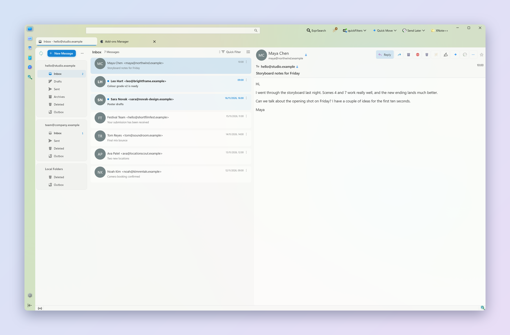
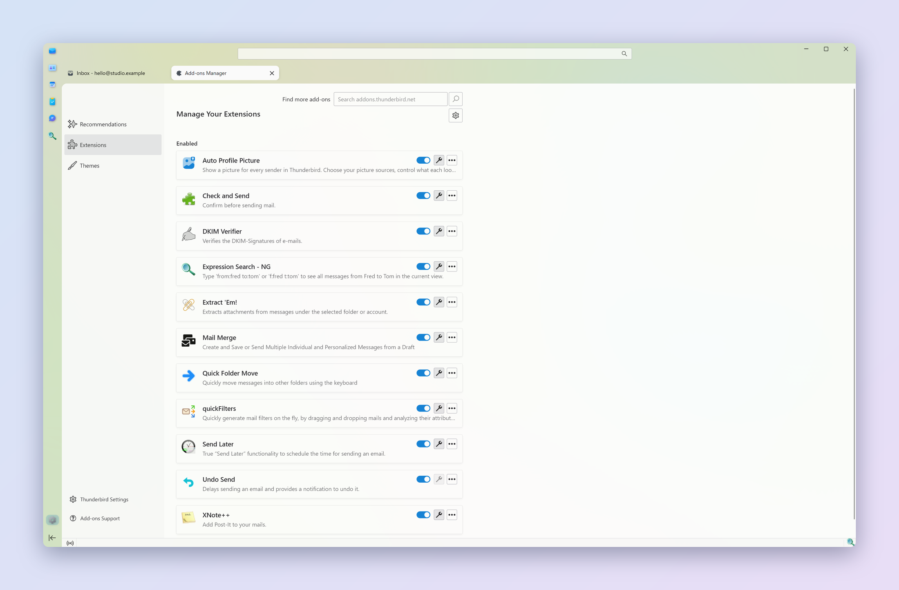
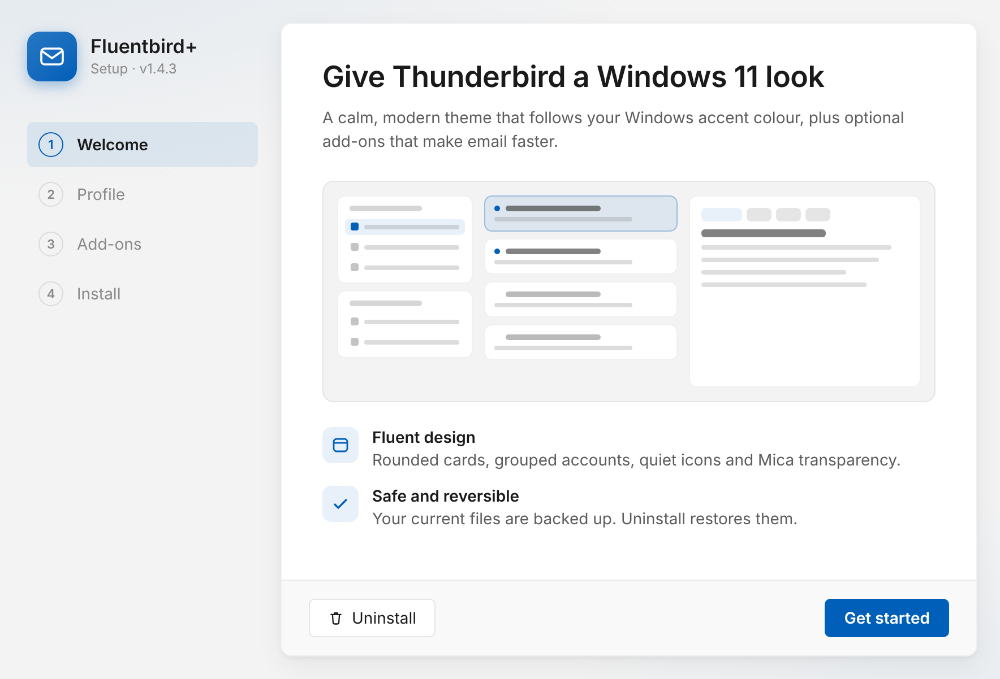
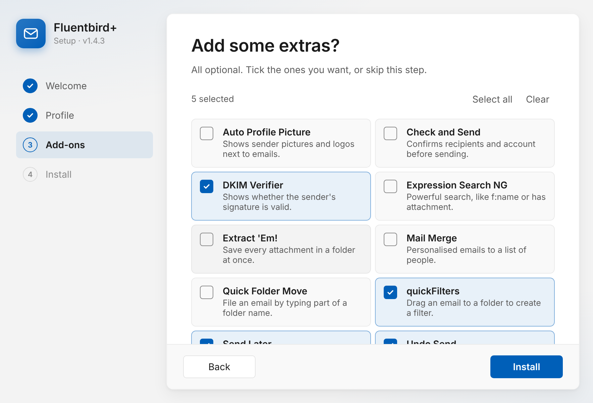
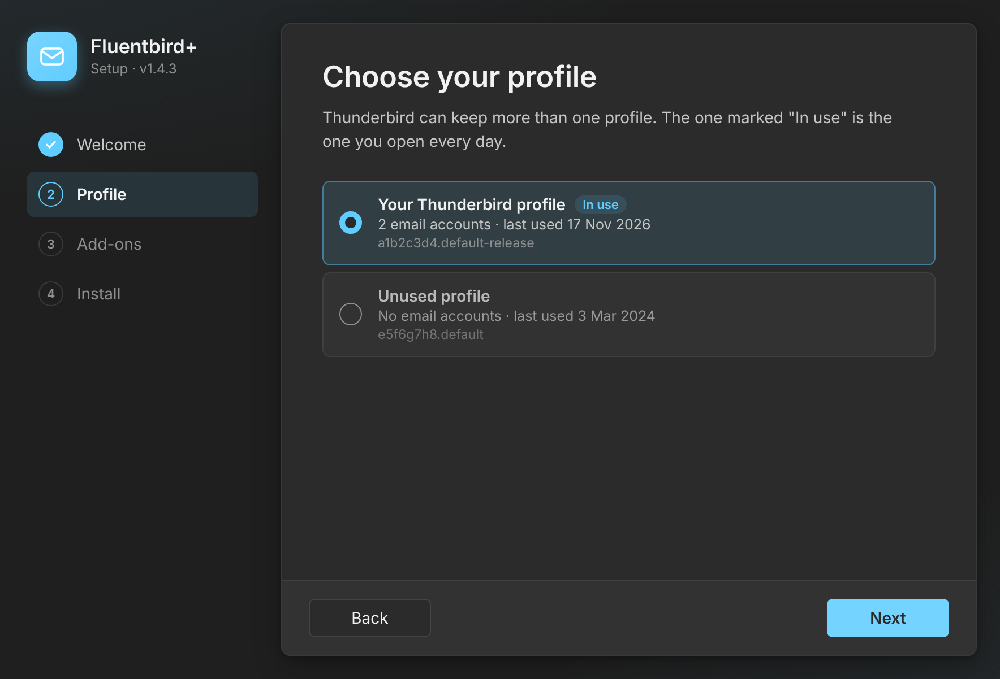
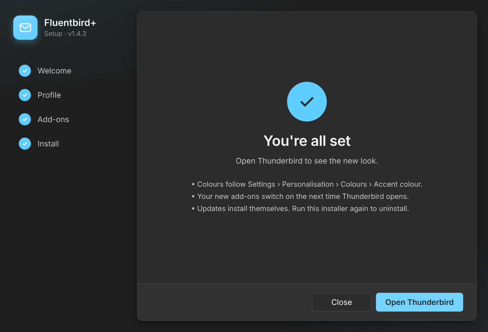

<p align="center"></p>

<h1 align="center">Fluentbird+</h1>
<p align="center">A Windows 11 look for Thunderbird, plus handy add-ons, in one click.</p>
<p align="center"><b>English</b> · <a href="README.fa.md">فارسی</a></p>

<p align="center"></p>

> **Built on [Fluentbird](https://github.com/Deathbyteacup/fluentbird) by Danny King.**
> Fluentbird gives Thunderbird its Windows 11 Fluent Design and Mica look. That core design is
> Danny's work. If you like it, please give [Fluentbird](https://github.com/Deathbyteacup/fluentbird) a star.

## Fluentbird and Fluentbird+

| | Fluentbird | Fluentbird+ adds |
|---|---|---|
| Design | Fluent Design, Mica, Fluent icons, rounded cards | Accent-colour highlights, grouped accounts, calm folder icons, unread dot, one-row message header |
| Install | Copy files and change settings by hand | One installer, with a clean uninstall |
| Add-ons | | 11 optional add-ons, ticked in the installer |
| Updates | | Optional automatic updates |

Fluentbird+ ships Fluentbird's files unchanged. Its own changes live in a separate
[`custom.css`](custom.css), the file Fluentbird provides for personal tweaks.
The original Fluentbird readme is kept in [docs/FLUENTBIRD.md](docs/FLUENTBIRD.md).


## What you get

- **Fluent design**: rounded cards, each account in its own group, calm icons, Mica transparency.
- **Follows your accent colour**: change it in Windows Settings and Thunderbird follows.
- **Clear unread mail**: a small accent dot and a bold sender.
- **Tidy message header**: one row of icon buttons that stays put.
- **Light and dark**: follows your Windows theme.
- **Optional add-ons**: tick the ones you want and the installer does the rest.

| Add-on | What it does |
|---|---|
| Auto Profile Picture | Sender pictures and logos next to emails |
| Check and Send | Confirm recipients and account before sending |
| DKIM Verifier | Shows if the sender's signature is valid |
| Expression Search NG | Powerful search, like `f:name` or `has:attachment` |
| Extract 'Em! | Save every attachment in a folder at once |
| Mail Merge | Personalised emails to a list of people |
| Quick Folder Move | File an email by typing part of a folder name |
| quickFilters | Drag an email to a folder to create a filter |
| Send Later | Write now, send at the time you choose |
| Undo Send | A few seconds to cancel after Send |
| XNote++ | Private sticky notes on emails |

<p align="center"></p>

## The installer

<p align="center">
  
  
</p>
<p align="center">
  
  
</p>

## Install

1. Download `FluentbirdPlus-Setup.exe` from [Releases](../../releases/latest).
2. Close Thunderbird.
3. Run the installer, pick your profile and tick the add-ons you want.
4. Open Thunderbird.

Windows may show "Windows protected your PC" because the file is new and not code-signed.
Click **More info → Run anyway**. Every release is built from this source code by
[GitHub Actions](.github/workflows/release.yml), and a SHA-256 checksum is attached.

Needs Windows 10 or 11 with the WebView2 Runtime (included in Windows 11). Without it, run
`FluentbirdPlus-Setup.exe --console` for a text version. Mica transparency needs Windows 11.

### About "full access" add-ons

Six of the add-ons (Auto Profile Picture, Expression Search NG, Mail Merge, Quick Folder Move,
Send Later, XNote++) use Thunderbird's Experiment APIs, which give an add-on full access.
Thunderbird only accepts these through its official enterprise policy. So if you tick one:

- Windows asks once for admin permission.
- Thunderbird's settings show a "managed by your organization" line while they are installed. This is normal and goes away when you uninstall.
- The add-ons may need a minute after Thunderbird first opens to switch on. If one says "incompatible", restart Thunderbird once.

Mozilla plans to phase out Experiment add-ons over time. If an author stops updating one,
it may stop working in a future Thunderbird.

## Privacy and safety

- No telemetry, no accounts, no analytics.
- It never opens your email, contacts or passwords. It reads `profiles.ini` to find your profile.
- It only connects to `addons.thunderbird.net` for add-ons you tick, and to GitHub once a day if automatic updates are on.
- Each download is checked against the SHA-256 checksum published by that site, and the add-on ID must match.
- It runs as a normal user. Admin permission is only asked for the full-access add-ons, and only to add or remove Thunderbird's add-on install policy.

### What it changes

| Where | Change |
|---|---|
| `<profile>\chrome\` | Theme files. Your own folder, if any, is moved to the backup first. |
| `<profile>\user.js`, `prefs.js` | Theme settings. Earlier values are saved. |
| `<profile>\extensions\` | Only the add-ons you pick. |
| `<profile>\fluentbird-plus-backup\` | Everything needed to undo the install. Removed on uninstall. |
| `HKCU\Software\Policies\Mozilla\Thunderbird\Extensions\Install` | Only for full-access add-ons. Removed on uninstall. |
| `%LOCALAPPDATA%\FluentbirdPlus\` | Downloaded add-ons and the update log. Removed on uninstall. |

## Automatic updates

On the add-ons step there is a **Keep Fluentbird+ up to date** switch.

- Once a day a Windows scheduled task, **Fluentbird+ Update**, checks this repository's latest release.
- If there is a newer version, it downloads it, checks it against the `.sha256` file from the release, and refreshes the theme. Your settings stay as they are.
- It runs as you, with no admin rights. The log is in `%LOCALAPPDATA%\FluentbirdPlus\update.log`.
- Turn it off by running the installer again with the switch off, or by uninstalling.

## Uninstall

Run the installer again and click **Uninstall**. Thunderbird goes back to how it was before:

- Theme files are removed, and your own `chrome` folder comes back if you had one.
- `user.js` and the theme settings get their earlier values back, or Thunderbird's defaults.
- You choose which add-ons to remove. The ones the installer added are ticked for you.
- The add-on policy, the update task and `%LOCALAPPDATA%\FluentbirdPlus` are removed.

If there is no record of the earlier state (for example, Fluentbird was set up by hand),
everything goes back to Thunderbird's defaults.

## Build it yourself

```
CGO_ENABLED=0 GOOS=windows GOARCH=amd64 go build -trimpath \
  -ldflags "-H windowsgui -X main.appVersion=1.4.3 -X main.updateRepo=OWNER/fluentbird-plus" \
  -o FluentbirdPlus-Setup.exe ./installer
```

Without `updateRepo`, the automatic update switch is hidden. To publish a release,
push a tag like `v1.4.3`. GitHub Actions builds the installer and attaches it with its checksum.

| Path | What it is |
|---|---|
| `userChrome.css`, `Icons/`, `Titlebar_Icons/` | Fluentbird, unchanged |
| `custom.css` | The Fluentbird+ design layer |
| `installer/` | The Windows installer (Go + WebView2) |
| `installer/ui/index.html` | The installer's interface |

## Credits

- **Theme:** [Fluentbird](https://github.com/Deathbyteacup/fluentbird) by Danny King, MIT licence. Fluentbird+ would not exist without it.
- **Icons:** Fluent UI System Icons by Microsoft, MIT licence.
- **Add-ons:** each belongs to its author. Fluentbird+ only downloads them from addons.thunderbird.net when you ask.
- Full licence texts: [LICENSE](LICENSE) and [NOTICE.md](NOTICE.md).
